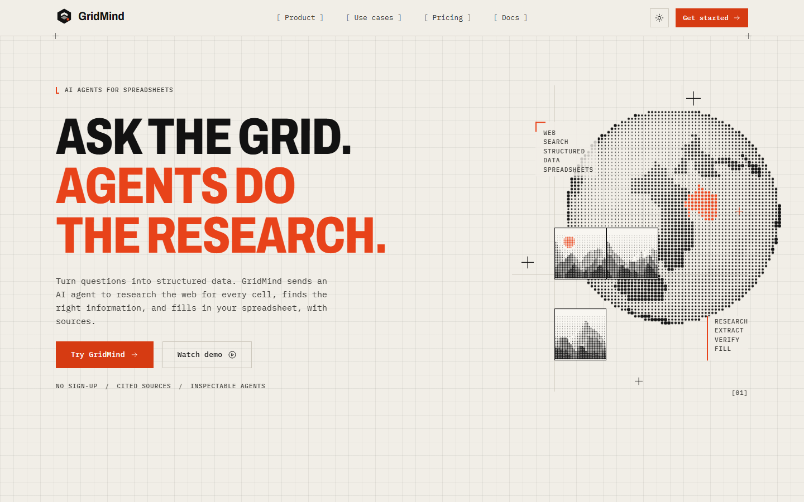
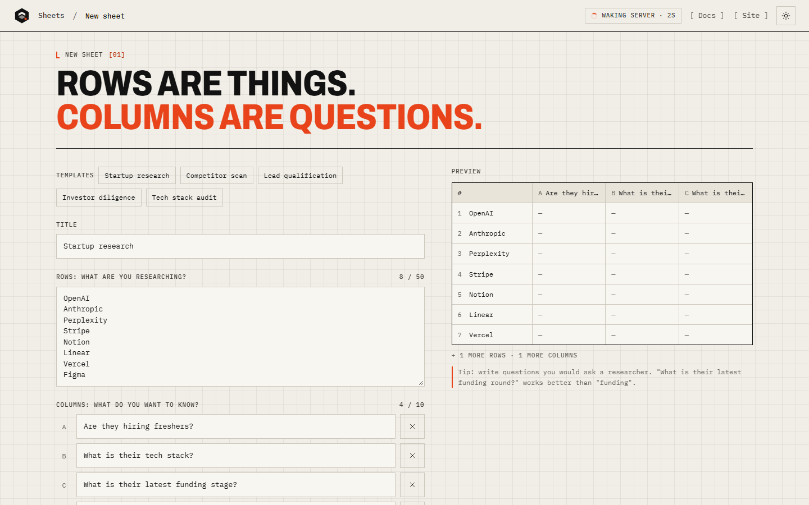
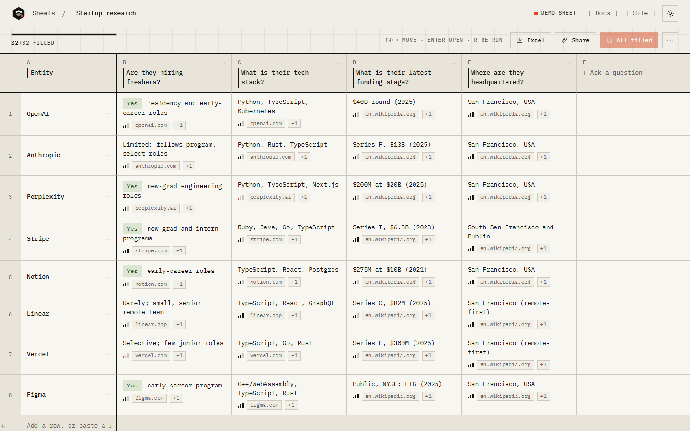
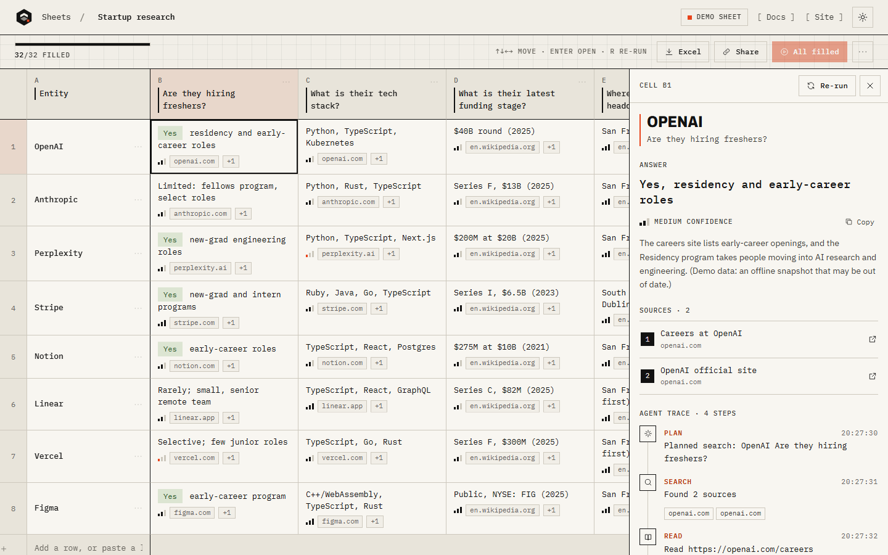
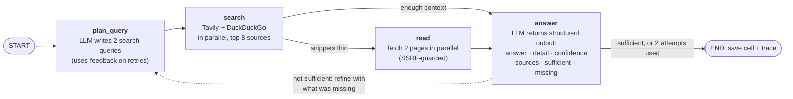
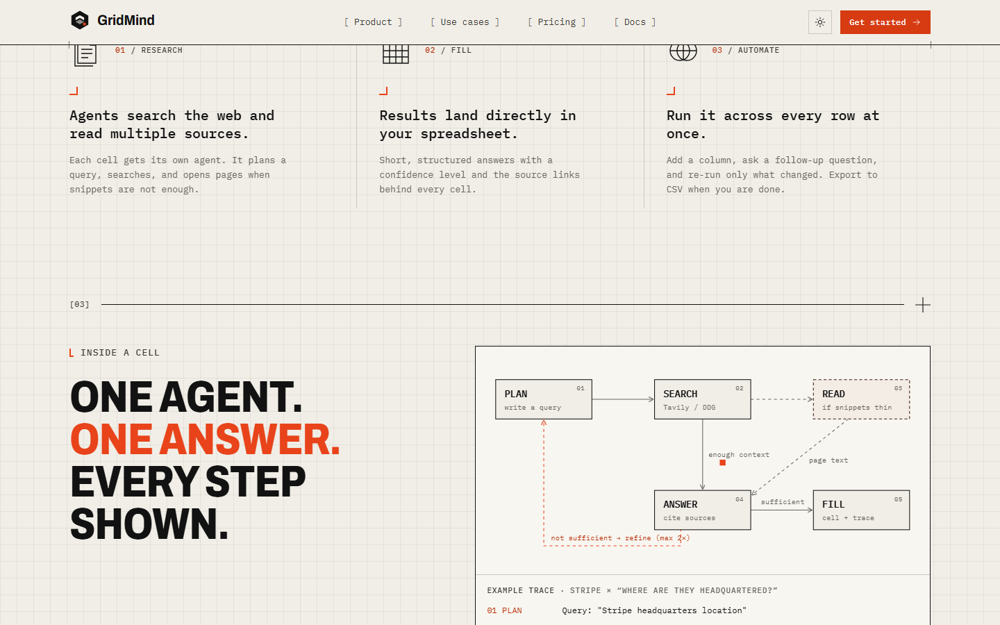
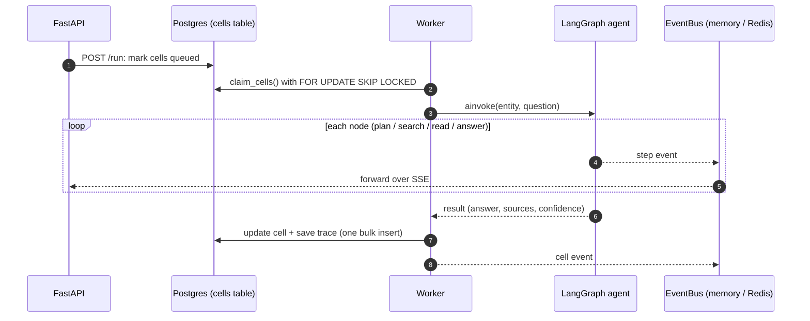

<div align="center">

# GridMind

**A spreadsheet that researches for you.**
Rows are things (companies, people, products). Columns are plain-English questions.
Hit **Run** and one AI agent per cell searches the web, answers, and cites its sources.




</div>

## What it does

1. **Create a sheet.** List the things you are researching and the questions you want answered, or start from a template.
2. **Run.** Every cell gets its own agent. The grid fills live as answers arrive.
3. **Inspect.** Each answer has a confidence level, up to four cited sources, and a step-by-step agent trace.

| Create a sheet | Watch it fill | Inspect any cell |
|---|---|---|
|  |  |  |

## The agentic flow

Each cell is researched by a small **LangGraph** state machine ([`backend/app/agent/graph.py`](backend/app/agent/graph.py)). It plans queries, searches, reads pages only when the snippets are thin, then answers. If the answer says the evidence was not sufficient, it feeds back what was missing and loops, at most twice.



Design points:

- **Dependency injection.** The graph never calls an LLM or the network directly. Everything goes through `AgentDeps` (`plan`, `search`, `read`, `answer`), so tests run the real graph against fakes and providers are swappable.
- **Structured output.** The answer node returns a Pydantic model, not free text. Cited URLs are checked against the sources actually retrieved, so the agent cannot cite a page it never saw.
- **Live trace.** Every node emits a step event as it runs. Steps stream to the browser over SSE and are saved to the database once, when the cell finishes.
- **Bounded cost.** Roughly one LLM call per cell, at most two research passes, at most four sources per answer.

<p align="center"></p>

## How a cell gets run

The agent graph sits inside a small job system. Postgres is the queue, and workers are stateless.



## System-design decisions

| Question | Decision |
|---|---|
| Where does the queue live? | In Postgres (`cells.status = queued`). No extra infra, survives restarts, inspectable. |
| Many instances picking the same job? | `claim_cells()` RPC uses `FOR UPDATE SKIP LOCKED`; claims are exclusive. |
| Instance dies mid-cell? | Claims carry `locked_at`; stale locks (>180s) are reclaimed, giving at-least-once execution. Graceful shutdown requeues in-flight cells. |
| Poison or flaky cells? | Bounded attempts with exponential backoff (future `queued_at`), then an `error` state. One bad cell never blocks others. |
| Free-tier rate limits (Groq ~30 RPM, Tavily credits)? | Per-instance sliding-window limiters, retry with jitter on 429/5xx (honours `Retry-After`), TTL cache plus in-flight de-dup of identical searches and page reads, DDG fallback when Tavily is exhausted. |
| Live updates across instances? | Events go through an `EventBus`: in-memory by default, Redis pub/sub when `REDIS_URL` is set. Events are best-effort; the DB is the source of truth and the client refetches a snapshot on SSE `ready`. |
| DB write amplification? | Status writes only on transitions; the trace is saved in one bulk insert at the end. Step events stream live without touching the DB. |
| Stale results after edits? | Editing a row or column deletes its cells; a result for a deleted or edited cell is discarded. |
| Abuse / cost control? | Row and column caps, input length limits, per-IP run and create limits, SSRF guard on page fetches (public IPs only, including redirects), prompt-injection-aware system prompt. |
| Split API from workers? | `RUN_WORKER=false` makes an API-only instance; all state is external, so each side scales independently. |
| Auth? | v1: an unguessable UUID per sheet (capability URL). Supabase Auth later means `owner_id` plus RLS. |

Known limits: per-IP and LLM/search rate limits are per instance (use Redis counters to make them global). Render's free tier sleeps when idle; the first request wakes it, and the stale-lock reclaim covers interrupted work.

## Project layout

```
backend/
  app/agent/      LangGraph cell agent (graph.py) and provider wiring (deps.py)
  app/runs/       job service and the worker loop (claim, run, persist, retry)
  app/api/        FastAPI routes, including the SSE events stream
  app/events.py   EventBus (in-memory or Redis)
  app/resilience.py  rate limiters, retries, TTL cache
  app/store.py    Supabase / in-memory repository
  supabase/       schema.sql (tables and the claim_cells RPC)
  tests/          agent and API tests
frontend/         Svelte 5 + Vite SPA (see frontend/DESIGN.md)
render.yaml       Render Blueprint for the API
```

## Frontend

A Svelte 5 + Vite SPA with plain CSS on design tokens ([frontend/DESIGN.md](frontend/DESIGN.md)). It has a landing page with a live demo sheet, a sheet editor (inline edit, paste a list to add rows, run all, by row or column, or re-run a cell, keyboard navigation, CSV and Excel export), a trace drawer, pricing, use cases and docs.

With no `VITE_API_URL`, or while the API is unreachable, it runs in **demo mode**: sheets live in `localStorage` and a simulated worker pool replays scripted agent traces, so the UI works with no backend at all.

## Run locally

```bash
cd backend
cp .env.example .env        # add GROQ_API_KEY (+ TAVILY_API_KEY, SUPABASE_* for real persistence)
uv sync
uv run uvicorn app.main:app --reload
uv run pytest
```

```bash
cd frontend
cp .env.example .env.local   # VITE_API_URL=http://localhost:8000 (leave empty for demo mode)
npm install
npm run dev                  # http://localhost:5173
npm run check && npm run build
```

Without `SUPABASE_*` the backend falls back to an in-memory store. For Supabase, run `backend/supabase/schema.sql` in the SQL editor first.

## API

| Endpoint | Purpose |
|---|---|
| `POST /api/sheets` | Create a sheet |
| `GET /api/sheets/{id}` | Sheet snapshot (rows, columns, cells) |
| `POST /api/sheets/{id}/columns`, `/rows`, `/run` | Add questions or rows; start agents |
| `PATCH` / `DELETE /api/columns/{id}`, `/api/rows/{id}` | Edit or remove |
| `GET /api/sheets/{id}/events` | Live cell and step events (SSE) |
| `GET /api/cells/{id}/steps` | Saved agent trace for a cell |
| `GET /api/status` (also `/healthz`) | Health check |

## Deploy

- **API:** Render Blueprint (`render.yaml`); set env vars from `backend/.env.example`.
- **UI:** Vercel, root directory `frontend` (Vite preset; `vercel.json` adds the SPA rewrite and asset caching). Set `VITE_API_URL` to the Render URL and add the Vercel URL to the API's `FRONTEND_ORIGIN`.
